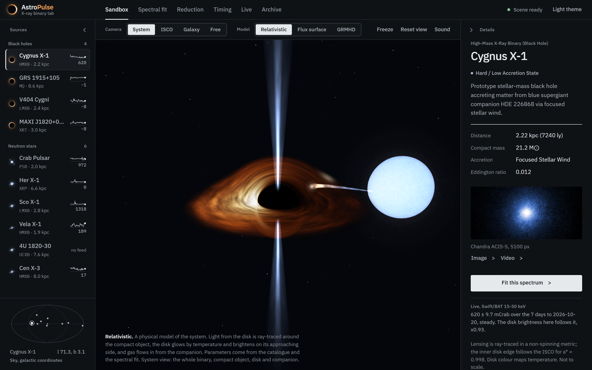
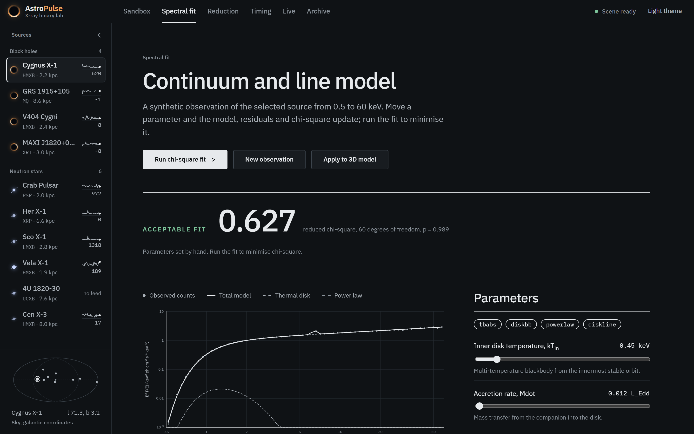
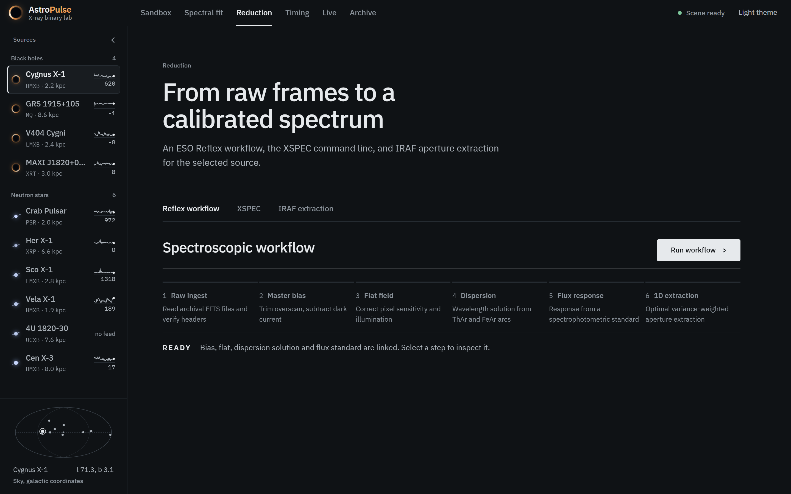
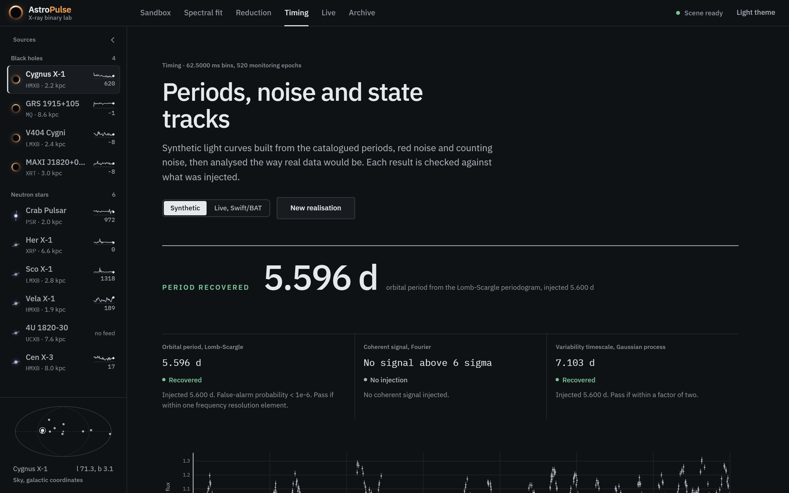
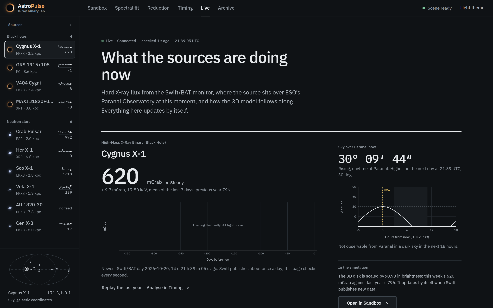
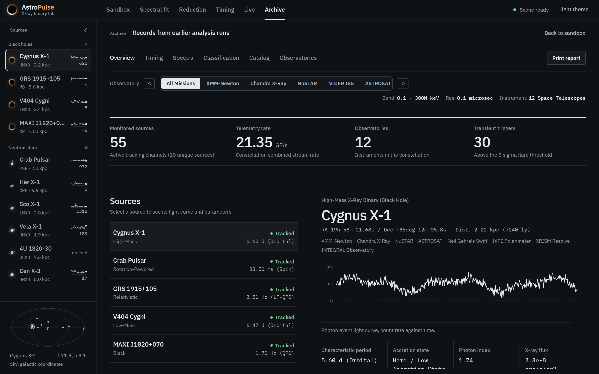
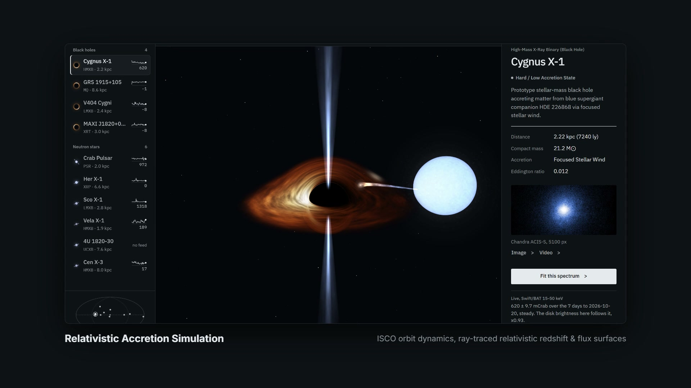
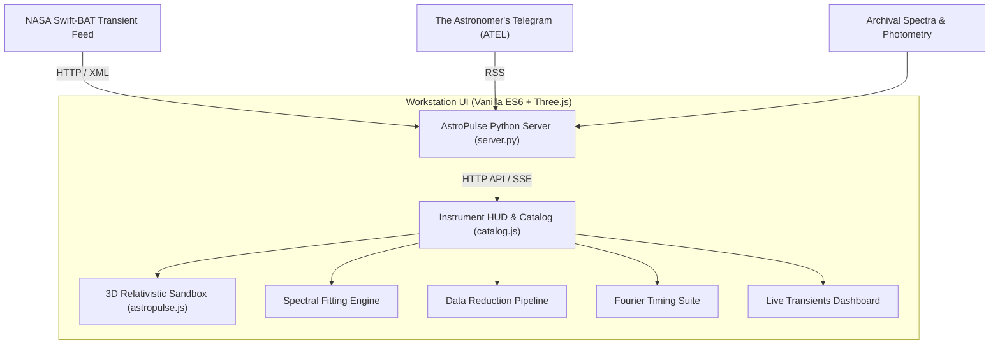

# AstroPulse — High-Energy Astrophysics Observing Workstation

[](LICENSE)
[](https://python.org)
[](https://threejs.org)
[](https://swift.gsfc.nasa.gov/results/transients/)

> **"Fit it, then trust it."** — An interactive observing workstation for high-energy astrophysics, compact object accretion physics, and transient monitoring.

AstroPulse provides researchers, astrophysicists, and students with an integrated laboratory for studying galactic black hole candidates and neutron star binaries. It pairs real-time relativistic ray-traced accretion geometry with analytical multi-component spectral fitting, Fourier timing analysis, and live feeds from NASA's Neil Gehrels Swift Observatory and The Astronomer's Telegram (ATEL).

---

## Video & Visual Overview

https://github.com/user-attachments/assets/demo (Video preview: see `docs/brag.mp4`)


*Figure 1: 3D Relativistic simulation of a stellar-mass black hole accretion disk with Doppler boosting and gravitational redshift.*

---

## Core Capabilities

| Capability | Module | Description |
|---|---|---|
| **3D Relativistic Sandbox** | `astropulse.js`, Three.js | Real-time Kerr and Schwarzschild accretion disk simulation. Visualizes the Innermost Stable Circular Orbit (ISCO), relativistic beaming, gravitational redshift, and flux surfaces derived from calibrated photon counts. Supports System, ISCO, Galactic, and Free camera trajectories. |
| **Spectral Fitting** | `spectral-view` | Multi-component X-ray spectral modeling (`diskbb` multicolor accretion disk + power-law Comptonized corona + relativistic Gaussian Fe Kα emission line at 6.4 keV + photoelectric absorption $N_H$). Evaluates reduced $\chi^2$, parameter error contours, and model residuals. |
| **Data Reduction Pipeline** | `pipelines-view` | Interactive event calibration workbench: converts raw satellite photon events into scientifically valid spectra and light curves. Includes Good Time Interval (GTI) selection, energy filtering, dead-time correction, and background subtraction. |
| **Timing Analysis** | `timing-view` | Fourier timing suite for high-energy light curves: Power Density Spectra (PDS), Quasi-Periodic Oscillation (QPO) centroid detection, fractional rms variability, and dynamic time-frequency spectrograms. |
| **Live Spacecraft Feeds** | `server.py`, `live-view` | Automated ingestion and caching of the NASA Swift-BAT hard X-ray transient monitor (15–50 keV) and real-time alerts from The Astronomer's Telegram (ATEL RSS), matched against cataloged compact binaries. |
| **Compact Object Catalog** | `catalog.js`, `catalog.json` | Curated multi-wavelength archival records, coordinates, spin estimates, binary orbital periods, and distance measurements for landmark sources: Cygnus X-1, Crab Pulsar, GRS 1915+105, MAXI J1820+070, Sco X-1, V404 Cygni, Cen X-3, Vela X-1. |

---

## Gallery & Interface Tour

| | |
|---|---|
| <br/>**Multi-Component Spectral Modeling**<br/>Simultaneous fit of disk blackbody, power law, and iron fluorescence with residual tracking. | <br/>**Photon Event Reduction**<br/>Filter raw event lists, apply calibration matrices, and extract clean FITS-ready spectra. |
| <br/>**Fourier Timing & QPO Search**<br/>Power spectral density calculation, Lorentzians fitting, and orbital modulation analysis. | <br/>**NASA Swift-BAT & ATEL Feed**<br/>Live transient flux monitoring (15-50 keV) directly from NASA Goddard space flight center. |
| <br/>**Source Catalog & Sky Map**<br/>All-sky Galactic coordinates map with multi-epoch spectral state classifications. | <br/>**High-Energy Astrophysics Console**<br/>Engineered with high information density, tabular telemetry, and zero unnecessary visual bloat. |

---

## System Architecture



### Key Physics & Mathematical Formulations

1. **Relativistic Beaming & Doppler Factor**:
   $$\delta = \frac{1}{\Gamma (1 - \beta \cos \theta)}$$
   The local emission intensity on the accretion disk is boosted by $\delta^3$ for continuum emission, producing the characteristic asymmetric flux brightening on the approaching disk limb.
2. **Standard Thin Accretion Disk (Shakura-Sunyaev / Novikov-Thorne)**:
   $$T(r) = \left\{ \frac{3 G M \dot{M}}{8 \pi \sigma r^3} \left[ 1 - \left( \frac{R_{\text{in}}}{r} \right)^{1/2} \right] \right\}^{1/4}$$
   The local temperature profile scales as $r^{-3/4}$ at large radii, peaking just outside the innermost stable circular orbit ($R_{\text{in}} = R_{\text{ISCO}}$).
3. **Power Density Spectrum**:
   $$P(\nu_j) = \frac{2}{\langle x \rangle^2 T} |X(\nu_j)|^2$$
   Normalized in fractional rms-squared units ($(\text{rms}/\text{mean})^2 \cdot \text{Hz}^{-1}$) following the Miyamoto / Belloni convention.

---

## Getting Started

### Prerequisites
- Python 3.10+ (Standard library only; no external pip dependencies required for basic workstation mode).
- Any modern web browser supporting WebGL (Chrome, Edge, Firefox, Safari).

### Quick Start (Windows)
Double-click **`AstroPulse.pyw`**. The application launches the internal server and opens in a focused, standalone workstation window.

### Quick Start (CLI / macOS / Linux)

```bash
# Clone the repository
git clone https://github.com/NoelMS/AstroPulse.git
cd AstroPulse

# Start the server (default port 8000, or specify a custom port)
python server.py 8000

# Open your browser at http://localhost:8000
```

To automatically launch the browser window:
```bash
python server.py --open
```

---

## Technical Design Standards

- **Zero Heavy Frameworks**: Built using clean standard-compliant ES6 JavaScript, modern CSS custom properties, and Three.js r128 without large npm dependency trees.
- **Instrument Console Typography**: IBM Plex Sans for legible editorial hierarchies, paired with tabular IBM Plex Mono for scientific figures, timestamps, and error tolerances.
- **Accessible & Responsive**: Fully keyboard navigable (`Tab`, `Enter`, view hotkeys), high-contrast dark/light theme switching, and strict adherence to `prefers-reduced-motion`.

---

## License

This project is open source and available under the [MIT License](LICENSE).
